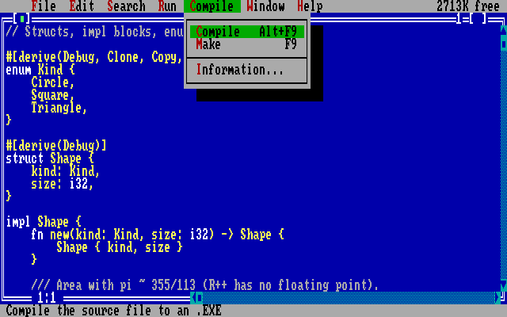

# rusty486

A fantasy 486 PC written in Rust: a real i486 CPU core paired with a mix of
genuine PC chips and simple custom hardware, plus (eventually) a PICO-8-style
built-in editor and an MCP server so Claude Code can drive the machine.

## Status

**Milestone 1, done:** real-mode CPU, BIOS, text mode, boots a floppy.

- CPU: i486 real mode, including 32-bit operand/address prefixes and the
  386/486 two-byte opcodes. Validated against the
  [SingleStepTests 80386](https://github.com/SingleStepTests/80386) real-mode
  suite: all 1,758,700 tests pass, except 32 documented 386EX-specific cases
  (`crates/core/tests/singlestep_known.txt`).
- BIOS (NASM): INT 10h video, INT 13h disk (CHS + LBA extensions), INT 19h
  boot, plus the small services DOS expects.
- Frontend (SDL2): 80x25 colour text mode, throttled to 33 MHz.

**Milestone 2, done:** MCP server, so Claude Code can see and drive the running machine.

**Milestone 3, done:** DOS-style code editor with a built-in NASM-syntax assembler.

- `rusty486-asm`: assembles the full 486 integer instruction set, `%define`,
  `%macro`, `%rep`, `times`, local labels and `$`/`$$` expressions. Its output
  is byte-identical to NASM for the BIOS and an ~450-form coverage file.
- Editor: press **Esc** to switch between the machine and the editor. Grey
  menu bar, blue editing window, syntax highlighting, mouse and keyboard
  selection, clipboard, undo, and inline error highlighting. F2 saves, F9
  builds, **Ctrl+F9** (or Ctrl+R) builds and runs. It reloads files changed on
  disk by other programs.

**Milestone 4, done:** 8259 PIC, 8254 PIT, RTC/CMOS and the custom
keyboard/mouse device; BIOS keyboard (INT 09h/16h) and timer (INT 08h/1Ah)
services.

**Milestone 5, done:** TinyDOS, a small MS-DOS 5 compatible OS written in
assembly (`dos/`): FAT12/FAT16 with subdirectories, an INT 21h subset (console,
files, directories, find first/next, memory, EXEC of .COM and MZ .EXE,
TSRs), an INT 33h mouse driver and COMMAND.COM (DIR, TYPE, COPY, DEL, REN,
MD, RD, CD, MEM, DATE, TIME, ECHO, PAUSE, HISTORY, DIR /W /P, batch files,
AUTOEXEC.BAT). The command line has DOSKEY-style editing: Up/Down history
(32 commands), F3, Left/Right/Home/End and Ctrl+arrows, Insert/overwrite,
Esc, and Tab completion of files, directories, programs and commands (a
second Tab lists the matches).
Drive C: is a persistent 32 MB TinyDOS disk in `%USERPROFILE%\rusty486\hdd.img`.

**Milestone 6, done:** protected mode (descriptors, privilege levels, call
gates, interrupt/trap gates with TSS stack switches, LDT/TR, I/O permission
bitmap), virtual-8086 mode and paging (TLB, accessed/dirty bits, page
faults). Passes the complete [test386.asm](https://github.com/barotto/test386.asm)
ROM (fetch it with `scripts/fetch-test386.ps1`), including its arithmetic
reference output. Not emulated: hardware task switching.

**Milestone 7, done:** graphics. Mode 13h (320x200x256) and VESA VBE 2.0
modes up to 640x480 at 8/15/16/32 bpp (banked window at A0000h and a linear
framebuffer at E0000000h), a 256-colour DAC, retrace status at 3DAh, BIOS
pixel/palette/font services and text drawing in mode 13h.

**Milestone 8, done:** sound. A YM3812 (OPL2/AdLib) FM synthesizer
(9 channels, waveforms, envelopes, feedback, tremolo/vibrato, rhythm mode,
detection timers), a Sound Blaster 2.0 DSP (8-bit PCM by single-cycle or
auto-init DMA, IRQ 5), an 8237 DMA controller, the PC speaker, and a
44.1 kHz mixer played through SDL (`--mute` to silence). TinyDOS sets
`BLASTER=A220 I5 D1 T3`.

**Milestone 9, done:** the editor's asset tabs. **Sprites** (64 16x16
sprites with the 256-colour palette, `data\SPRITES.BIN`), **Map** (64x32 tile
map painted with the sprites, `data\MAP.BIN`), **Sound** (16 OPL2 instruments
with a live keyboard piano, `data\INSTR.BIN`) and **Disks** (drive manager:
browse and delete files on mounted images, new TinyDOS floppies, insert,
eject, save). Everything in `data\` is copied onto the program's disk.

**Milestone 10, done:** **Rustland R++**, a Borland C++-style IDE for R++, a
subset of Rust, that runs inside TinyDOS. Type `RUSTLAND` on drive C: (the
examples are in `C:\RPP`: `CD RPP`, `RUSTLAND SNAKE`). Ctrl+F9 compiles and
runs, Alt+F9 compiles, F1 has the language reference. See
[Rustland R++](#rustland-r) below.

**Memory:** the machine has 128 MB of RAM. Rustland runs at 4-32 MB; R++
programs load at 32 MB and their heap runs to the top of RAM (the DOS
extender asks the BIOS how much there is).

## Rustland R++



The IDE is real Rust (`crates/rustland`, `no_std`) built for
`i586-unknown-linux-gnu`, linked at 4 MB and packed into `RUSTLAND.EXE` with a
DOS extender stub (`dos/pmstub.asm`): the stub loads the 32-bit image above
1 MB, switches to flat protected mode and thunks back to real mode for DOS and
BIOS calls. The compiler (`crates/lang`, `no_std` + `alloc`) is the same
crate the host tests use; it emits x86 machine code directly and packs the
program with the same stub, linked at 32 MB (the IDE uses 4-32 MB).

- **Editor:** menus (F10/Alt+letter), syntax colours, insert/overwrite,
  Shift+arrow selection, Ctrl+Ins/Shift+Ins/Shift+Del clipboard, undo
  (Alt+BkSp), find (Ctrl+F, Ctrl+L), go to line (Ctrl+G), auto-indent, file
  dialog (F3), save (F2), DOS shell.
- **Build:** compile errors appear in the Message window and move the cursor
  to the error (F6 for the next one). Ctrl+F9 runs the program with optional
  arguments (Run > Arguments); Alt+F5 shows the user screen again.

**R++** supports functions, `let`/`mut`, `i8`-`u32`, `isize`/`usize`, `bool`,
`char`, `&str`, arrays, slices (`&a[1..3]`), references and raw pointers,
structs with `impl` blocks and methods, C-like enums, `const`/`static`,
`if`/`while`/`loop`/`for` (ranges, `.rev()`, `.step_by()`, `&array`,
`.chars()`), `match` with literals, ranges, `|` and guards, and `print!`,
`println!`, `panic!`, `assert!`, `assert_eq!` with `{}`, `{:?}`, `{:x}`,
widths and alignment. Indexing is bounds-checked and panics like Rust.
Untyped integer literals take their type from how a variable is used.
A prelude (written in R++) adds `read_line`, `read_key`, `key_pressed`,
`args`, `parse_int`, `file_read`/`file_write`, `put_pixel` and mode 13h,
`put_char_at`, `gotoxy`, `sleep_ms`, `beep`, `random_range`, `alloc` and
`dos_int` for any DOS or BIOS call.

Not supported: generics, traits, closures, tuples, `Option`/`Result`,
`String`/`Vec`/`Box`, floating point, 64-bit integers, modules, and the borrow
checker. Programs are therefore "Rust-shaped" rather than full Rust; real rustc
cannot run on the emulated machine.

### R++ Write

**R++ Write 2.0** (`C:\WRITE`, source `C:\RPP\WRITE.RS`) is a word processor for
writing books, written in R++ on a small ncurses-style library. Type
`CD \WRITE` and `WRITE SAMPLE` to open the sample book.

- **Menus** in the Rustland style (File, Edit, Search, Format, Style, View,
  Book, Options, Help) with dialogs, buttons and shadows.
- **Files:** New, Open (file list), Save, Save as, Export text, Rename,
  Delete, with prompts for unsaved changes. `.WP` keeps all formatting;
  export writes Markdown-style text (`#` chapter, `##` section, `>` quote),
  which Open imports.
- **Formatting:** bold, italic, underline, strikethrough, highlighting,
  change case, left/centre/right/justified paragraphs; paragraph styles for
  chapter and section headings, block quotes, scene breaks, bullet and
  numbered lists, and writer's notes (kept out of the word count and the
  export).
- **Book tools:** chapter outline with word counts and pages (F5), page
  breaks, statistics (F9), a session word goal with a progress bar, focus
  mode (F7), typewriter scrolling, auto-save.
- **Settings (F8):** first-line indent on/off and size, space between
  paragraphs, page length, word goal, colours; saved automatically.
- **Editing:** selection, cut/copy/paste, multi-step undo (a log of
  changes), find, replace all, go to page, word and chapter movement;
  documents up to 2,000,000 characters (about 330,000 words), after which
  it offers to continue in the next numbered file (BOOK2.WP...).
- **Colours:** Borland Blue, Paper, Amber and Midnight themes, saved with
  the other options in `WRITE.CFG`.

`dos/write/` holds the built program, its README and the sample book
(`scripts/make-write-sample.py`). `cargo run -p rusty486-lang --bin rppc --
FILE.RS` compiles R++ on the host.

To rebuild the IDE and R++ Write after changing `crates/rustland`, `crates/lang`
or `WRITE.RS`:

```powershell
rustup target add i586-unknown-linux-gnu
scripts/build-rustland.ps1        # writes RUSTLAND.EXE and dos/write/WRITE.EXE
```

The emulator copies the current `RUSTLAND.EXE` to `C:\` on every start and the
examples to `C:\RPP` if they are missing.

## Roadmap

1. ~~Real-mode boot to text~~
2. ~~MCP server (local HTTP + token) so Claude Code can drive the machine~~
3. ~~Code editor with a built-in NASM-syntax assembler~~
4. ~~Interrupts, timer, RTC, keyboard and mouse~~
5. ~~TinyDOS~~
6. ~~Protected mode and paging~~
7. ~~VBE graphics~~
8. ~~OPL2 + Sound Blaster + PC speaker~~
9. ~~Sprite, map, sound and disk editors~~
10. ~~A Borland-style IDE and compiler for a Rust subset, running inside TinyDOS~~

## Building

Requirements: Rust (MSVC toolchain on Windows), CMake and a C compiler
(Visual Studio Build Tools). The BIOS and TinyDOS are assembled at build time
by rusty486's own assembler; NASM is only used (if present) by tests that
compare against it.

```sh
cargo run --release -p rusty486-sdl                     # boots the built-in demo floppy
cargo run --release -p rusty486-sdl -- --fda disk.img   # boot your own image
```

Options: `--project DIR`, `--fda/--fdb/--hda/--hdb IMG`, `--mhz N`,
`--mcp-port N`, `--no-mcp`. Keys: F12 opens the editor (Esc returns), Ctrl+F9
builds and runs, F11 resets, Pause pauses, **Ctrl+F12 opens Settings**,
**Alt+Enter toggles fullscreen**; everything else goes to the guest.

### Settings window

Ctrl+F12 opens a graphical Settings window over the display (mouse or
keyboard: arrows, Enter/Space, Tab between the sections and the page, Esc):

- **Video:** fullscreen, aspect ratio (4:3 CRT, square pixels, stretch),
  integer scaling, smooth filtering, CRT scanlines, window size.
- **Emulation:** CPU speed (5-100 MHz), pause/resume, reset, pause while the
  menu is open.
- **Drives:** A: to D: with Insert (a picker of `.img` files from the rusty486
  folder, the project and the current directory, or a typed path), Eject and
  Save; a new blank TinyDOS floppy; save all disks.
- **Audio:** mute and volume.
- **Connection:** MCP server address and a button that copies the
  `claude mcp add` command.

Settings are saved in `%APPDATA%\rusty486\settings.json`; `--mhz` and
`--mute` override them for one session. Over MCP, `get_settings`,
`set_setting` and `settings_menu` do the same (and `screenshot` with
`view: "settings"` shows the window). Disk images the guest writes to are saved when
you close the window.

## Projects

A project is a folder (default `%USERPROFILE%\rusty486\default`, created on
first run from a template):

```text
project.toml      name = "...", entry = "src/main.asm"
src/main.asm      your program: org 0x100, loaded at 1000:0100 like a DOS .COM
build/main.bin    the assembled program
build/disk.img    a bootable 1.44 MB floppy: bios/loader.asm + the program
```

The assembler is also available on the command line:
`cargo run -p rusty486-asm --example r486asm -- in.asm out.bin`.

## MCP server (Claude Code integration)

While the window is open, rusty486 serves MCP over streamable HTTP at
`http://127.0.0.1:8486/mcp`. It only listens on localhost and requires a bearer
token, generated on first run and stored in `%APPDATA%\rusty486\mcp-token`. On
startup it prints the exact command to register it:

```sh
claude mcp add --scope user --transport http rusty486 http://127.0.0.1:8486/mcp \
  --header "Authorization: Bearer <token>"
```

| Tool | What it does |
|------|--------------|
| `status` | Running/paused (and why), CS:IP, cycles, disks, breakpoints |
| `screenshot`, `screen_text` | The screen as a PNG or as plain text with the cursor position |
| `get_registers`, `set_register` | CPU state |
| `read_memory`, `write_memory` | Hex dump / poke; addresses as `SEG:OFF` (e.g. `cs:0100`) or linear hex |
| `pause`, `resume`, `step`, `run`, `reset` | Execution control; `run` waits for emulated time or a breakpoint |
| `breakpoint_add`, `breakpoint_remove` | Execution breakpoints |
| `debug_log` | Text written to debug port E9h (the BIOS mirrors its output there) |
| `disk_insert`, `disk_eject`, `disk_save`, `disk_list` | Mount raw `.img` files (can create blank ones) |
| `load_file` | Copy a flat binary into memory and optionally jump to it |
| `project_info`, `read_source`, `write_source` | The open project and its source files |
| `assemble`, `build`, `build_and_run` | Built-in assembler; `build_and_run` is the editor's Ctrl+F9 |
| `set_view` | Show the machine or the editor (`screenshot` takes `view` too) |
| `get_settings`, `set_setting`, `settings_menu` | Host settings (video, speed, audio) and the Settings window |
| `type_text`, `press_key` | Keyboard input for the guest |
| `dos_command` | Type a TinyDOS command and return the screen |
| `disk_files`, `disk_read_file`, `disk_write_file`, `disk_delete` | Files on mounted FAT images |

Tool calls run on the UI thread between frames, so Claude and the window
always see the same machine.

## Tests

```sh
cargo test --release                    # unit + boot tests
scripts/fetch-tests.ps1                 # download the 386 CPU suite (~576 MB)
cargo test -p rusty486-core --release --test singlestep -- --nocapture
cargo test -p rusty486-lang --release   # R++ programs and the IDE, run under TinyDOS
```

`RUSTY486_TEST_FILTER=0F` limits the CPU suite to matching opcode files, and
`RUSTY486_TEST_VERBOSE=N` prints details for up to N failures per file.

## Layout

| Path | What |
|------|------|
| `crates/core` | Emulator core: CPU, bus, devices. No host I/O (WASM-ready). |
| `crates/asm` | NASM-syntax assembler. No host I/O (WASM-ready). |
| `crates/firmware` | BIOS + TinyDOS, assembled at build time; TinyDOS disk builder. |
| `crates/lang` | R++ compiler (`no_std`), PM stub packer, `pmpack` ELF packer. |
| `crates/rustland` | Rustland R++ IDE (bare-metal i586, built separately). |
| `dos/rustland/` | Built `RUSTLAND.EXE` and the example programs. |
| `dos/write/` | R++ Write: built `WRITE.EXE`, README and a sample book (installed as `C:\WRITE`). |
| `dos/` | TinyDOS sources: boot sector, kernel, COMMAND.COM. |
| `crates/sdl` | Desktop frontend (`rusty486` binary). |
| `bios/` | BIOS and demo boot sector (NASM). |
| `scripts/` | Helper scripts. |

## Hardware reference

| Device | Ports / memory |
|--------|----------------|
| RAM | 128 MB (640 KB conventional + extended); INT 15h 88h/E801h, CMOS 17h/30h/34h |
| Disk controller (custom, bus-mastering) | 300h-317h, see `crates/core/src/devices/disk.rs` |
| Text video + CRTC cursor | B8000h, 3D4h/3D5h |
| Fast A20 gate | 92h |
| Debug console (Bochs-style) | E9h |

## License

Dual-licensed under [MIT](LICENSE-MIT) or [Apache-2.0](LICENSE-APACHE).
